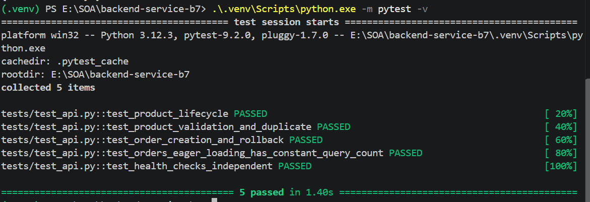
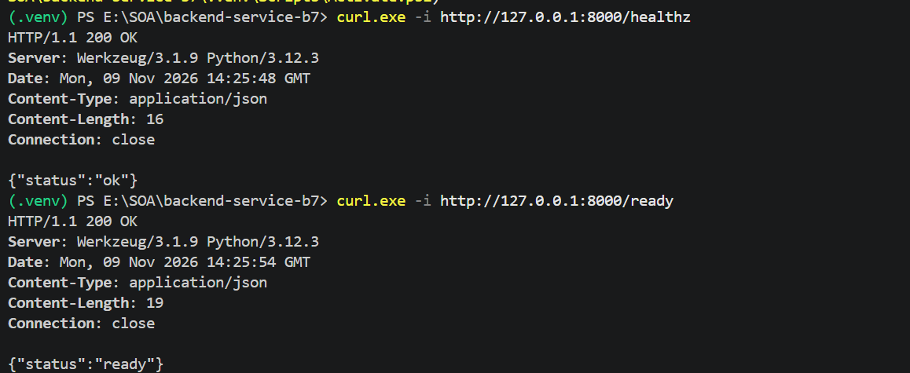
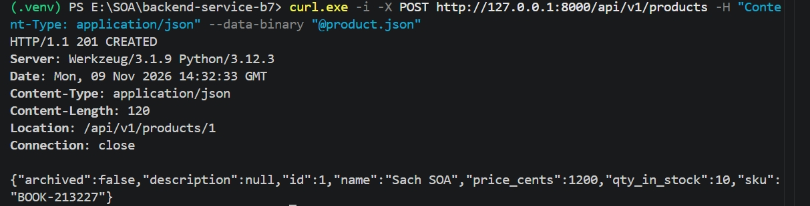
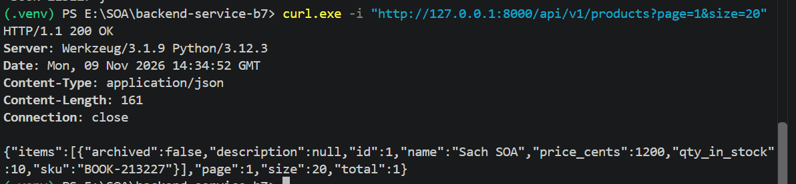
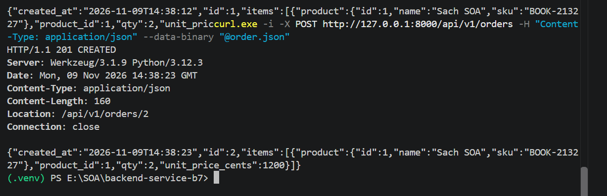
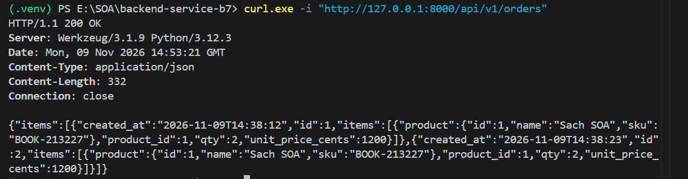

# Backend Service SOA Buổi 7


## Chạy local với SQLite

Từ thư mục dự án, dùng Python 3.12. Ví dụ PowerShell:

```powershell
python --version
python -m venv .venv
.\.venv\Scripts\python.exe -m pip install -r requirements-dev.txt
.\.venv\Scripts\python.exe -m flask --app wsgi db upgrade
.\.venv\Scripts\python.exe -m flask --app wsgi run --port 8000
```

Trên Linux/macOS, dùng `.venv/bin/python` thay cho `.\.venv\Scripts\python.exe`. SQLite mặc định lưu ở `instance/service.db`. Biến môi trường `DATABASE_URL` có thể ghi đè URL mặc định. Cần chạy `db upgrade` khi khởi tạo database hoặc có migration mới.

## Product API

| Phương thức và đường dẫn | Kết quả |
| --- | --- |
| `GET /api/v1/products?page=1&size=20` | 200 với `items`, `page`, `size`, `total`. Tối đa 100 mục mỗi trang |
| `GET /api/v1/products/<id>` | 200 với sản phẩm còn hoạt động hoặc 404 |
| `POST /api/v1/products` | 201 với sản phẩm mới và header `Location`. SKU trùng trả 409 |
| `PATCH /api/v1/products/<id>` | 200. Chỉ cập nhật `name` và `price_cents` có trong body |
| `POST /api/v1/products/<id>/reserve` | 200 với tồn kho mới. Thiếu hàng trả 409 |
| `DELETE /api/v1/products/<id>` | 204. Đánh dấu `archived=true` và ẩn khỏi danh sách, chi tiết |

Ví dụ tạo sản phẩm với `Content-Type: application/json`:

```json
{"sku":"BOOK-001","name":"Sách SOA","price_cents":1200,"qty_in_stock":10}
```

`sku` dài 3–32 ký tự và `name` dài 1–255 ký tự. `price_cents` và `qty_in_stock` là số nguyên không âm. Tồn kho mặc định là 0. `description` tùy chọn, tối đa 2000 ký tự. Body reserve có dạng `{"qty": 2}` với `qty` là số nguyên dương. Các thao tác trên sản phẩm đã lưu trữ trả 404. SKU vẫn duy nhất sau khi xóa mềm.

Lỗi trả JSON có `error` và `detail`. Validation schema và tham số phân trang sai kiểu trả 422. JSON lỗi cú pháp trả 400, sai media type trả 415.

## Order API

- `POST /api/v1/orders` trả 201 và `Location`.
- `GET /api/v1/orders` trả 200 với `items` là danh sách đơn.
- `GET /api/v1/orders/<id>` trả 200 với chi tiết đơn hoặc 404.

Ví dụ tạo đơn sau khi đã có sản phẩm 1 và 2 đủ tồn kho:

```json
{"items":[{"product_id":1,"qty":2},{"product_id":2,"qty":1}]}
```

Mỗi Order có nhiều OrderItem. Mỗi OrderItem trỏ tới một Product và lưu số lượng, đơn giá lúc đặt. Mỗi sản phẩm xuất hiện tối đa một lần trong đơn. Tạo đơn trừ tồn kho và lưu các dòng hàng trong cùng một giao dịch. Nếu bất kỳ dòng nào thiếu hàng hoặc trỏ đến sản phẩm không còn bán, cả giao dịch được rollback. GET tải trước OrderItem bằng `selectinload` và Product bằng `joinedload` trên truy vấn dòng hàng. Sản phẩm xóa mềm vẫn được hiển thị trong đơn cũ.

## Health checks

- `GET /healthz` trả 200 khi Flask phục vụ được request.
- `GET /ready` chạy `SELECT 1` để kiểm tra kết nối DB. Trả 200 khi kết nối được, 503 khi có lỗi.

## Chạy pytest

### 1. Automated Tests — Pytest

Kết quả: **5 tests passed**.



### 2. Health Checks

- `GET /healthz` — HTTP 200
- `GET /ready` — HTTP 200



### 3. Product API

**POST /api/v1/products**


**GET /api/v1/products**



### 4. Order API

**POST /api/v1/orders**



**GET /api/v1/orders**



### 5. Eager Loading & N+1 Queries

Sử dụng `selectinload()` và `joinedload()` để tránh N+1 Queries.

Pytest xác nhận GET Orders thực hiện đúng 2 SQL queries khi lấy 1 và 4 đơn hàng.

```powershell
.\.venv\Scripts\python.exe -m pytest -q
```

Test dùng SQLite in-memory. Ca kiểm tra eager loading đếm toàn bộ SQL trong request GET và yêu cầu đúng 2 truy vấn cho cả 1 và 4 đơn có sản phẩm riêng.

## Chạy Docker trên máy khác

Chép toàn bộ thư mục dự án sang máy có Docker Engine và Docker Compose. Từ thư mục dự án:

```sh
docker compose up --build -d
docker compose ps
curl http://localhost:8000/healthz
curl http://localhost:8000/ready
docker compose logs api
```

Compose khởi động PostgreSQL, đợi DB báo healthy, chạy migration, sau đó chạy Gunicorn ở cổng 8000. Dữ liệu PostgreSQL nằm trong volume `postgres_data`. Cấu hình tài khoản DB đi kèm dành cho lab. Dùng `docker compose down` để dừng service và giữ volume.

