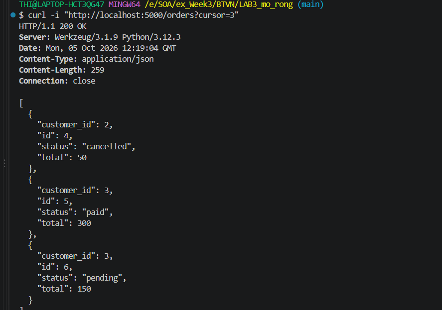
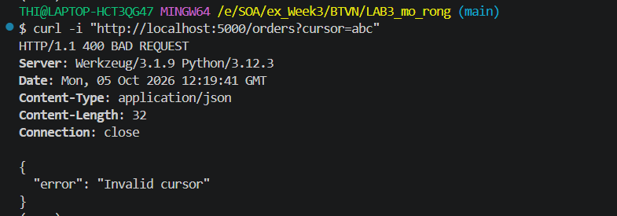
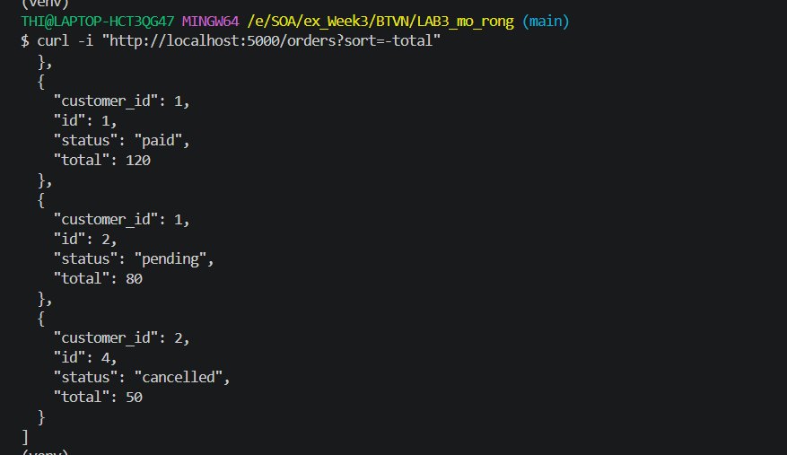

# Homework ý 1 - Bổ sung /orders

## Cursor Test

```bash
curl -i "http://localhost:5000/orders?cursor=3"
```


---

## Invalid Cursor Test

```bash
curl -i "http://localhost:5000/orders?cursor=abc"
```



---

## Sort Test

```bash
curl -i "http://localhost:5000/orders?sort=-total"
```

