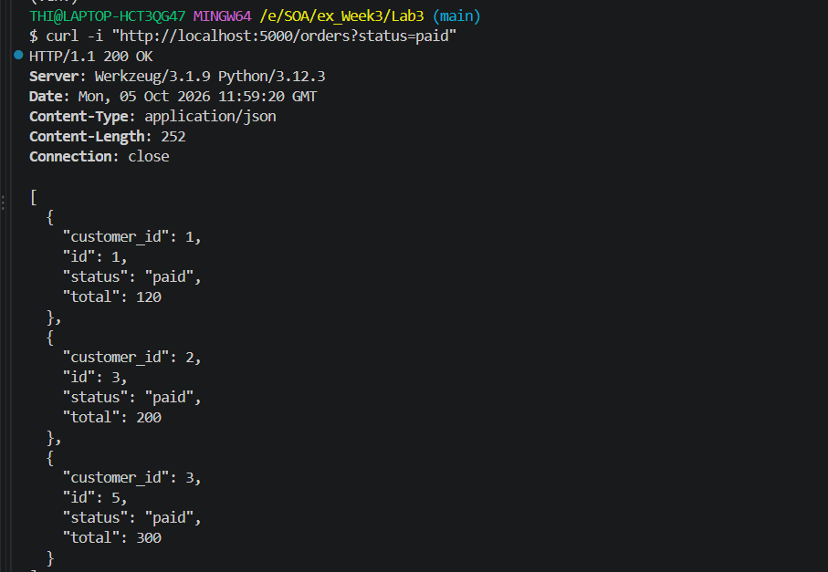
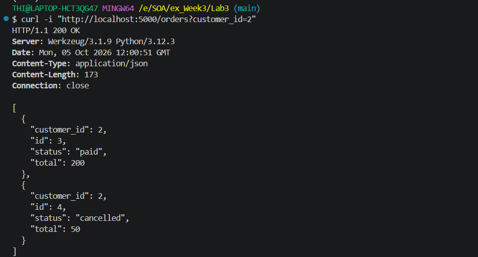
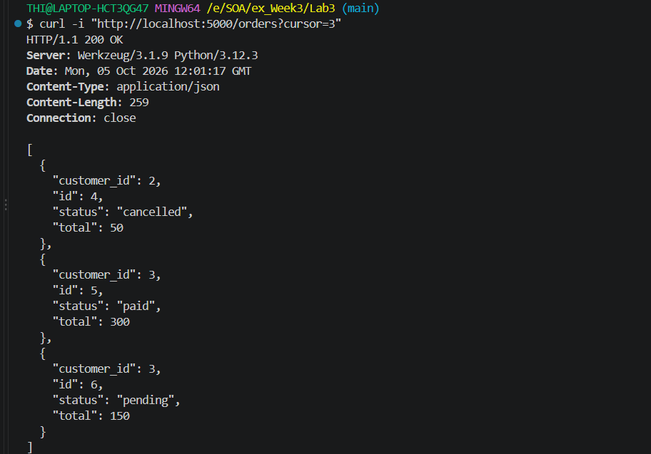
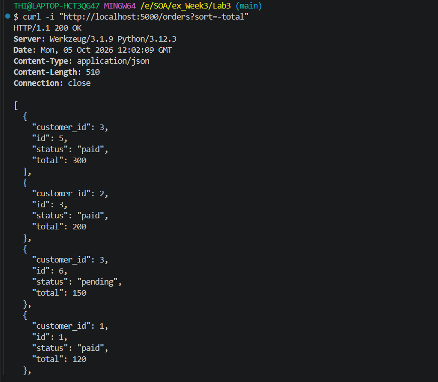
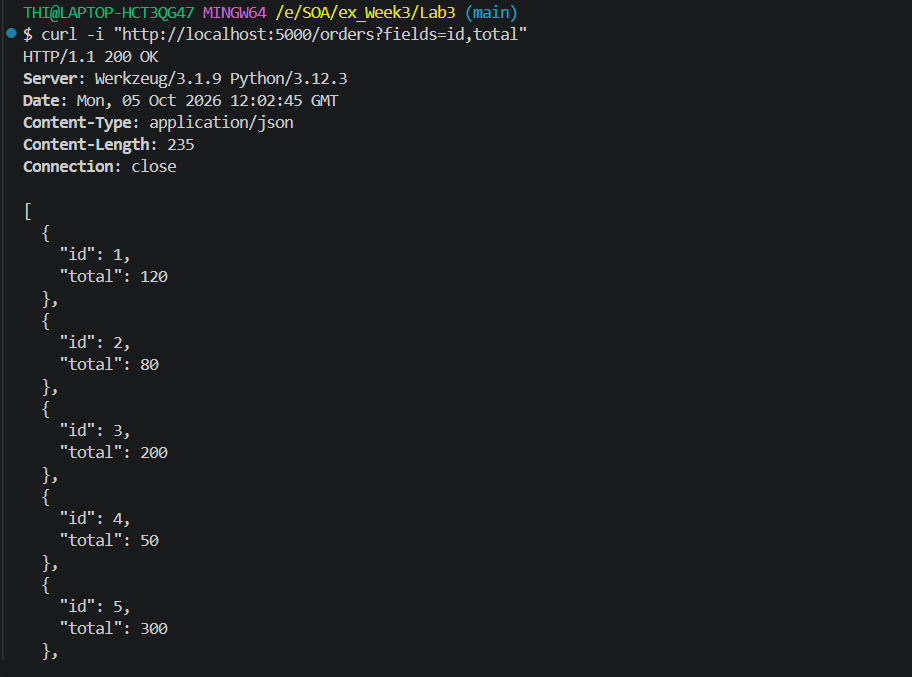
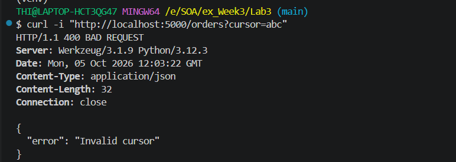

# Lab 3 - Orders Pagination API

## Filter

Request:

```bash
curl -i "http://localhost:5000/orders?status=paid"
```



---

## Customer Filter

Request:

```bash
curl -i "http://localhost:5000/orders?customer_id=2"
```



---

## Cursor Pagination

Request:

```bash
curl -i "http://localhost:5000/orders?cursor=3"
```



---

## Sort

Request:

```bash
curl -i "http://localhost:5000/orders?sort=-total"
```



---

## Sparse Fieldsets

Request:

```bash
curl -i "http://localhost:5000/orders?fields=id,total"
```



---

## Invalid Cursor (400 Bad Request)

Request:

```bash
curl -i "http://localhost:5000/orders?cursor=abc"
```

Expected Status:

```http
HTTP/1.1 400 BAD REQUEST
```
