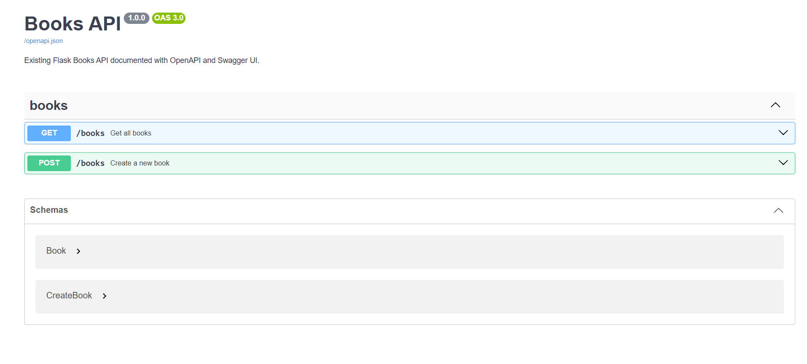
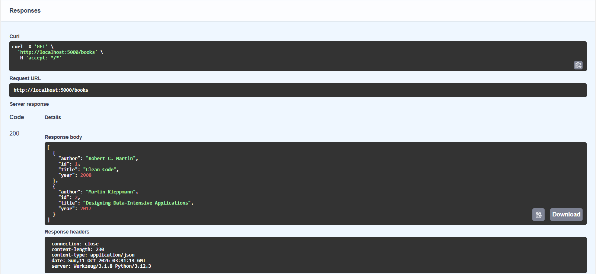
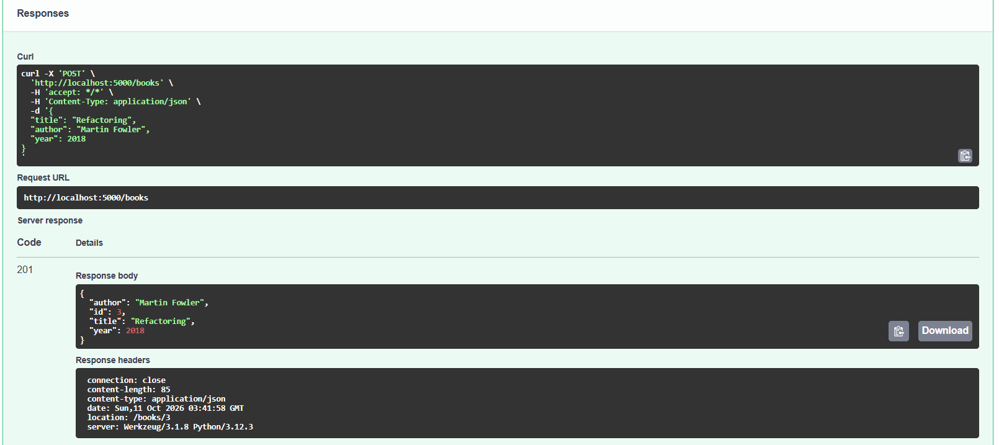
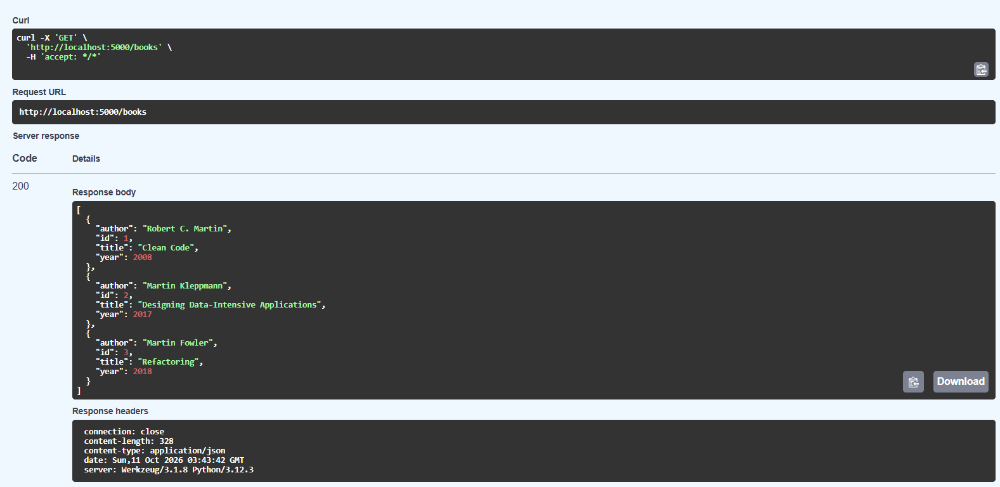

# ex_Week4

Bài tập Buổi 4: tích hợp OpenAPI Specification và Swagger UI vào Flask app có sẵn.

## Chức năng

- `GET /books`: API Flask mẫu có sẵn.
- `POST /books`: tạo book.
- `GET /openapi.json`: trả OpenAPI 3.0.3 specification.
- `GET /docs`: Swagger UI đọc specification từ `/openapi.json`.

## Chạy bài

```bash
pip install -r requirements.txt
python app.py
```

Mở trình duyệt:

- `http://localhost:5000/openapi.json`
- `http://localhost:5000/docs`
## Swagger UI

Truy cập `/docs` để xem tài liệu API được hiển thị bằng Swagger UI.



## Demo Try it out

### GET /books

Trong `/docs`, mở `GET /books` → **Try it out** → **Execute**.

API trả về danh sách 2 books ban đầu với status `200 OK`.



### POST /books

Trong `/docs`, mở `POST /books` → **Try it out** và với request body:

```json
{
  "title": "Refactoring",
  "author": "Martin Fowler",
  "year": 2018
}
```



### GET /books after POST

Thực hiện lại `GET /books` → **Try it out** → **Execute**.

API trả về `200 OK`. Danh sách lúc này có 3 books, bao gồm book vừa được tạo bằng `POST /books`.


## Ý nghĩa

- `/books`: Implementation (Flask code chạy thật).
- `/openapi.json`: Specification (mô tả API dạng machine-readable).
- `/docs`: Documentation (Swagger UI render từ specification).

