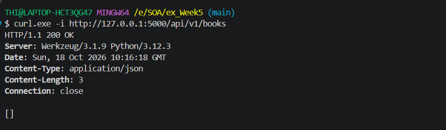
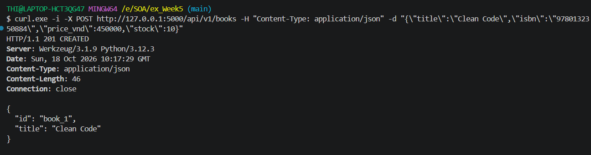
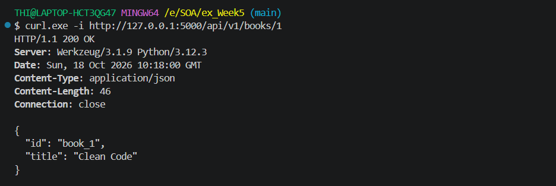
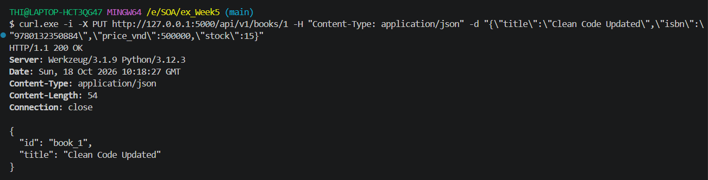
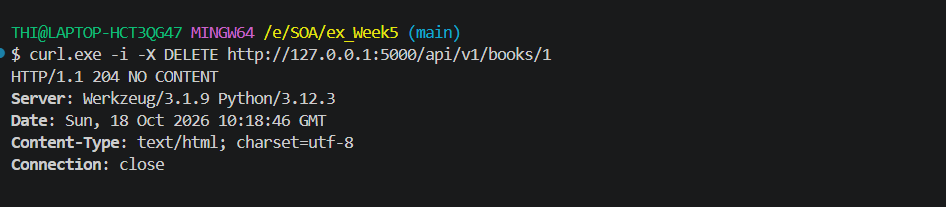

# Lab 1 - Bookstore API

## Mô tả

Xây dựng Bookstore API bằng Flask và SQLAlchemy.

Các thành phần chính:
- Data model: Book, Author, Category, User, Review.
- SQLite database.
- CRUD API cho Book.
- JSON Schema để validate dữ liệu đầu vào.

## Cài đặt và chạy

```bash
pip install flask flask-sqlalchemy jsonschema
python app.py
```

Server chạy tại:

```text
http://127.0.0.1:5000
```

## API Testing

### Test 1 - GET /books

Kiểm tra lấy danh sách tất cả books.

```bash
curl.exe -i http://127.0.0.1:5000/api/v1/books
```


---

### Test 2 - POST /books

Kiểm tra tạo một book mới.

```bash
curl.exe -i -X POST http://127.0.0.1:5000/api/v1/books -H "Content-Type: application/json" -d "{\"title\":\"Clean Code\",\"isbn\":\"9780132350884\",\"price_vnd\":450000,\"stock\":10}"
```

Kết quả mong đợi: `201 Created`.



---

### Test 3 - GET /books/{id}

Kiểm tra lấy thông tin book vừa tạo.

```bash
curl.exe -i http://127.0.0.1:5000/api/v1/books/1
```

Kết quả mong đợi: `200 OK`.



---

### Test 4 - PUT /books/{id}

Kiểm tra cập nhật thông tin book.

```bash
curl.exe -i -X PUT http://127.0.0.1:5000/api/v1/books/1 -H "Content-Type: application/json" -d "{\"title\":\"Clean Code Updated\",\"isbn\":\"9780132350884\",\"price_vnd\":500000,\"stock\":15}"
```

Kết quả mong đợi: `200 OK`.



---

### Test 5 - DELETE /books/{id}

Kiểm tra xóa book.

```bash
curl.exe -i -X DELETE http://127.0.0.1:5000/api/v1/books/1
```

Kết quả mong đợi: `204 No Content`.



## Kết quả

Lab 1 đã triển khai Bookstore data model, JSON Schema validation và các CRUD operations cơ bản cho resource Book.