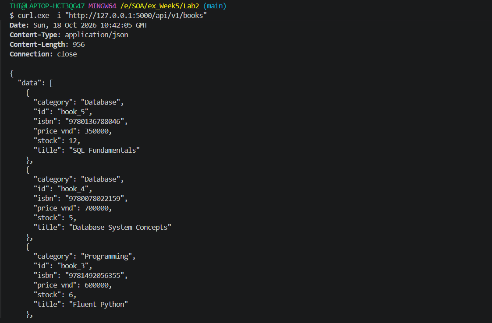
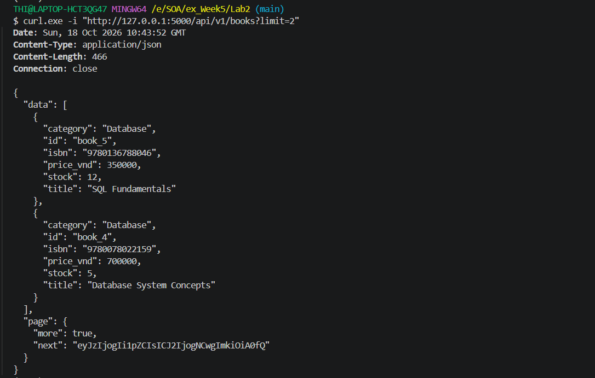
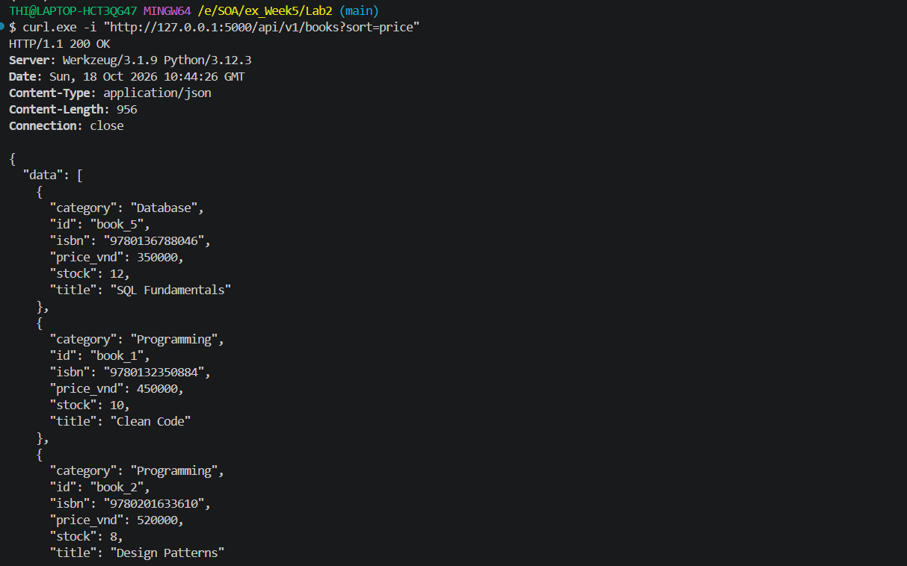
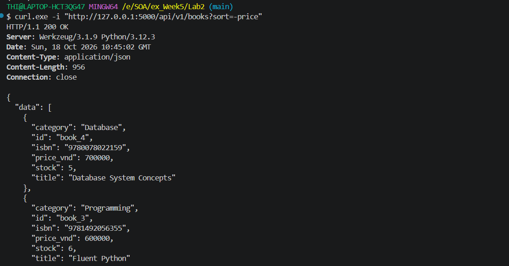
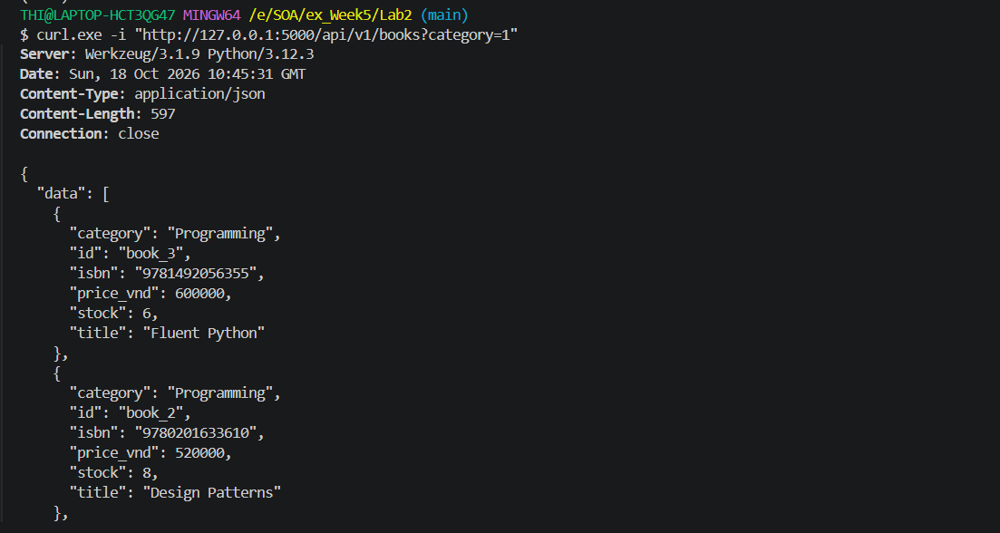
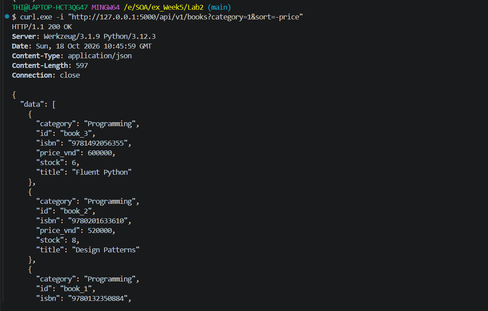
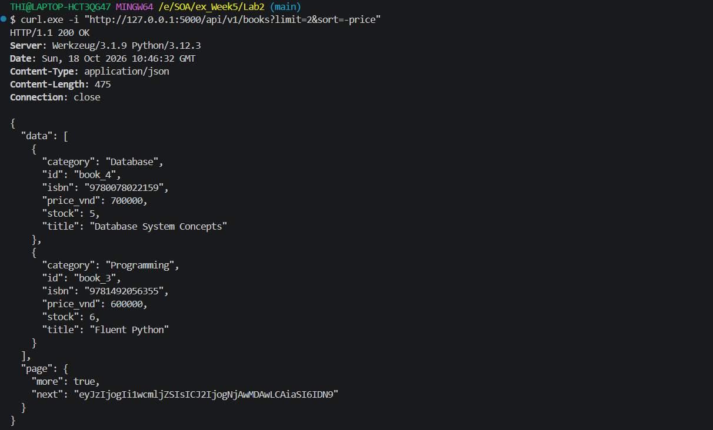
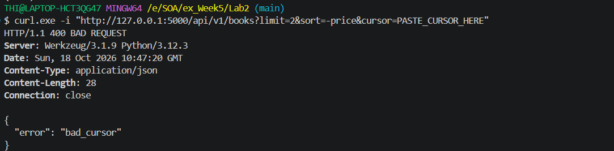
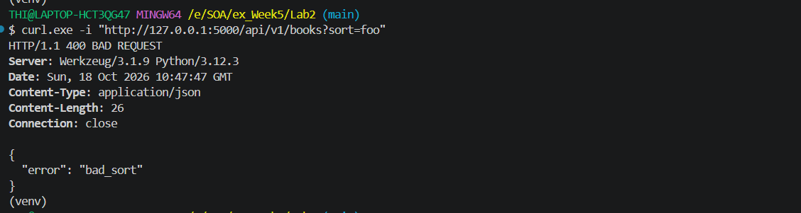

# Lab 2 - Filtering, Sorting and Cursor Pagination

## Mô tả

Mở rộng Bookstore API với:

- Filter theo `category`.
- Sort theo `id` hoặc `price`.
- Hỗ trợ sort tăng dần và giảm dần.
- Cursor pagination.
- Composite cursor sử dụng `(sort value, id)`.

## Chạy ứng dụng

```bash
python app.py
```

Server chạy tại:

```text
http://127.0.0.1:5000
```

## API Testing

### Test 1 - GET Books

Kiểm tra lấy danh sách books với mặc định `sort=-id`.

```bash
curl.exe -i "http://127.0.0.1:5000/api/v1/books"
```


---

### Test 2 - Limit

Kiểm tra giới hạn số lượng books trả về.

```bash
curl.exe -i "http://127.0.0.1:5000/api/v1/books?limit=2"
```

Kết quả trả về tối đa 2 books và cursor cho trang tiếp theo.



---

### Test 3 - Sort Price

Kiểm tra sắp xếp books theo giá tăng dần.

```bash
curl.exe -i "http://127.0.0.1:5000/api/v1/books?sort=price"
```



---

### Test 4 - Sort Price Descending

Kiểm tra sắp xếp books theo giá giảm dần.

```bash
curl.exe -i "http://127.0.0.1:5000/api/v1/books?sort=-price"
```



---

### Test 5 - Filter Category

Kiểm tra filter books theo category.

```bash
curl.exe -i "http://127.0.0.1:5000/api/v1/books?category=1"
```



---

### Test 6 - Filter + Sort

Kiểm tra kết hợp filter theo category và sort theo giá giảm dần.

```bash
curl.exe -i "http://127.0.0.1:5000/api/v1/books?category=1&sort=-price"
```



---

### Test 7 - Cursor Pagination

Lấy trang đầu tiên với `limit=2`:

```bash
curl.exe -i "http://127.0.0.1:5000/api/v1/books?limit=2&sort=-price"
```

Response trả về `next` cursor:

```json
"page": {
    "next": "...",
    "more": true
}
```


Copy giá trị `next` và truyền vào request tiếp theo:

```bash
curl.exe -i "http://127.0.0.1:5000/api/v1/books?limit=2&sort=-price&cursor=PASTE_CURSOR_HERE"
```



---

### Test 8 - Invalid Sort

Kiểm tra API từ chối sort key không được hỗ trợ.

```bash
curl.exe -i "http://127.0.0.1:5000/api/v1/books?sort=foo"
```

Kết quả mong đợi:

```text
HTTP/1.1 400 BAD REQUEST
```



## Kết quả

Lab 2 đã triển khai filtering, sorting và cursor pagination cho Bookstore API.